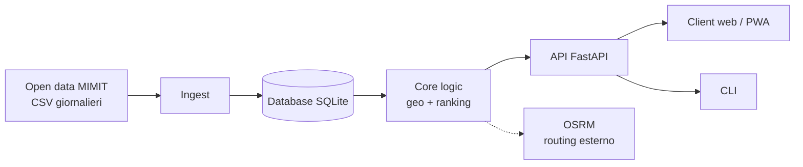

# Architettura di Benzinaio

Web app che aiuta a trovare il distributore di carburante più conveniente in Italia, partendo dalla posizione attuale o lungo un percorso, tenendo conto non solo del prezzo al litro ma del **costo reale** (prezzo + costo della deviazione).

I dati provengono dagli open data ufficiali del MIMIT (Ministero delle Imprese e del Made in Italy), licenza IODL 2.0.

## Funzionalità

1. **Vicino a me, con raggio in km.** Dalla posizione attuale e un raggio scelto dall'utente, elenca i distributori ordinati per prezzo o per costo reale.
2. **Costo reale.** Confronta i distributori in base a quanto si spende davvero, deviazione compresa.
3. **Lungo il percorso.** Dati partenza e arrivo, trova il distributore più conveniente lungo la strada.

### Cosa è stato escluso, e perché

- **Storico e andamento dei prezzi.** Non è utile al caso d'uso principale (decidere dove fare il pieno adesso) e complicherebbe il modello dati.
- **Pulizia avanzata dei dati.** Non è una funzionalità del progetto. Resta solo una validazione minima (prezzi nulli o assurdi, coordinate fuori dall'Italia) perché un prezzo a 0 falserebbe qualsiasi classifica.

## Panoramica



## Componenti

| Modulo | Responsabilità |
|---|---|
| `ingest.py` | Scarica i CSV, li valida (validazione minima), li carica nel database. Idempotente. |
| `db.py` | Accesso al database. Unico punto che conosce SQLite. |
| `geo.py` | Distanza di Haversine, bounding box, calcolo della deviazione. Funzioni pure. |
| `ranking.py` | Calcolo del costo reale e ordinamento dei risultati. Funzioni pure. |
| `api.py` | Endpoint FastAPI. Orchestra le altre parti, non contiene logica di calcolo. |
| CLI | Interfaccia da terminale per sviluppo e test, sopra la stessa logica dell'API. |

## Principi di progettazione

1. **Ingest e API sono indipendenti.** L'ingest è un job batch giornaliero. L'API risponde alle richieste in tempo reale. Comunicano solo tramite il database.
2. **La core logic è pura.** `geo` e `ranking` non dipendono da FastAPI né dal database: ricevono dati e restituiscono risultati, quindi si testano facilmente.
3. **L'ingest è idempotente.** Rieseguirlo non duplica i dati (chiave: impianto + carburante). Il database può essere ricostruito da zero in qualsiasi momento.
4. **Il routing è isolato dietro un'interfaccia.** OSRM è l'unica dipendenza esterna. Se non risponde, si ripiega sulla distanza in linea d'aria con un fattore correttivo. I risultati vengono messi in cache.
5. **I parametri dell'auto stanno nella richiesta.** Consumo, litri e carburante sono parametri, senza account né profili salvati.

## Modello dati

- `impianti`: `id_impianto` (chiave), `gestore`, `bandiera`, `nome`, `indirizzo`, `comune`, `provincia`, `lat`, `lon`
- `prezzi`: `id_impianto`, `carburante`, `prezzo`, `is_self` (chiave: `id_impianto` + `carburante` + `is_self`)

Non si conserva lo storico: a ogni ingest i prezzi vengono sostituiti (upsert).

## Flusso della ricerca "vicino a me"

La ricerca lavora in due fasi per non chiamare il routing su migliaia di impianti:

1. **Filtro veloce.** Bounding box attorno alla posizione, poi distanza di Haversine. Restano poche decine di candidati entro il raggio.
2. **Distanza stradale.** OSRM calcola la distanza reale solo sui candidati. Il raggio in km è quindi quello percorribile davvero.
3. **Ranking.** Si calcola il costo reale e si ordina.

## Costo reale

```
costo_reale = prezzo × litri + km_deviazione × (consumo_l_100km / 100) × prezzo
```

Nella ricerca "vicino a me" la deviazione è approssimata con andata e ritorno (2 × distanza stradale). Nella ricerca lungo il percorso è la differenza di lunghezza tra il tragitto con la sosta e quello senza.

## API (bozza)

- `GET /stations/nearby?lat&lon&radius_km&fuel&liters&consumption`
- `GET /stations/along-route?from&to&fuel&liters&consumption`

## Decisioni principali

| Decisione | Scelta | Motivo |
|---|---|---|
| Backend | FastAPI | Adatto a un'API che serve calcoli; tipizzazione e documentazione automatica. |
| Database | SQLite | Sufficiente per decine di migliaia di impianti; nessun costo né server. |
| Copertura | Tutta Italia | Il volume dei dati lo consente senza problemi. |
| Interfaccia | API + CLI prima, mappa web dopo | Qualcosa di usabile presto; la mappa (Leaflet) arriva in seguito. |
| Formato di rilascio | Web app mobile-first, installabile come PWA | La geolocalizzazione funziona nel browser; nessuno store; basta un link. |
| Routing | OSRM pubblico | Gratuito per una demo; self-hosting solo se necessario. |
| Costi | Zero | Hosting e strumenti solo gratuiti. |

## Dati e licenza

- Fonte: open data MIMIT (anagrafica impianti e prezzi praticati). Licenza IODL 2.0: **la fonte va citata** nel README e nell'interfaccia.
- I prezzi sono quelli comunicati dai gestori e aggiornati una volta al giorno: **non sono in tempo reale**.
- Il formato dei file è cambiato in passato (separatore di campo): il parser va verificato sui file reali.

## Esecuzione e deploy

1. **Sviluppo e demo in locale**, con Docker e test automatici.
2. **README curato**, con screenshot, una GIF della ricerca e il comando di avvio.
3. **Deploy gratuito** (Render) come ultimo passo. Su molti hosting gratuiti il disco è effimero e il servizio va in pausa dopo un periodo di inattività: per questo l'ingest ricostruisce il database da zero all'avvio e il README avvisa che la prima apertura può essere lenta.

Configurazione tramite variabili d'ambiente (percorsi, URL di OSRM, raggio massimo), mai scritta nel codice. Nessun segreto nel repository.

## Struttura del repository

```
benzinaio/
├── pyproject.toml
├── README.md
├── ARCHITECTURE.md
├── LICENSE
├── Dockerfile
├── data/                  # CSV scaricati (ignorata da git)
├── src/benzinaio/
│   ├── __init__.py
│   ├── ingest.py
│   ├── db.py
│   ├── geo.py
│   ├── ranking.py
│   └── api.py
├── tests/
│   ├── test_geo.py
│   └── test_ranking.py
└── .github/workflows/
    └── ci.yml             # ruff + pytest a ogni push
```

## Test e CI

- Test unitari su `geo` (distanze note) e `ranking` (casi con deviazione che ribalta la classifica).
- GitHub Actions esegue `ruff` e `pytest` a ogni push.

## Limiti noti

- Prezzi aggiornati una volta al giorno, non in tempo reale.
- Le coordinate degli impianti sono inserite dai gestori e possono contenere errori.
- Il server pubblico di OSRM ha limiti d'uso: adatto a una demo, non a un servizio con molti utenti.
